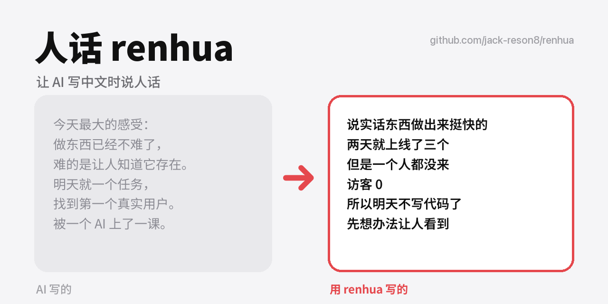

# 人话 renhua · để AI viết tiếng Trung như người thật

[English](README.md) | [简体中文](README.zh-CN.md) | [日本語](README.ja.md) | [한국어](README.ko.md) | Tiếng Việt | [हिन्दी](README.hi.md)

<p align="center"></p>

**Một Claude skill viết bài Xiaohongshu, bài X, nhật ký, giới thiệu sản phẩm và trả lời bình luận bằng giọng của một người thật: xóa dấu vết AI, thêm chút chất mạng và chút hài hước.**

Lưu ý: skill này viết nội dung **tiếng Trung** (人话 nghĩa là "lời nói bình thường của con người"). Nó hữu ích cho những ai đăng bài bằng tiếng Trung; README này được dịch cho những người còn lại.

Tiếng Trung do AI viết rất dễ nhận ra: danh sách emoji, câu liệt kê ba vế, kết bài kiểu khẩu hiệu, cấu trúc "不是……而是……" (không phải X mà là Y), và câu hỏi chốt bài quen thuộc. Skill này được chắt lọc từ 407 câu thật do một lập trình viên indie tự gõ (nhịp điệu, từ hay dùng, cách nhận xét). Bạn có thể thay bằng giọng của chính mình (xem bên dưới). Kèm theo là ba tệp tham khảo.

| Tệp | Nội dung |
|---|---|
| `plugins/renhua/skills/renhua/SKILL.md` | Cách nói của lập trình viên gốc, 8 loại dấu vết AI cần xóa, quy trình viết 5 bước, khác biệt giữa các nền tảng, so sánh giọng AI và giọng người |
| `…/references/examples.md` | Tiêu đề Xiaohongshu thật đã nổ, phân loại theo cấu trúc (tương phản + tự giễu / danh tính + thử thách + thời hạn / "làm thử X rồi đánh giá" / meme một câu), giọng sinh viên so với giọng creator công nghệ |
| `…/references/insight.md` | Cách viết nhận định cốt lõi và câu chốt: câu chủ đề đầu bài được nhắc lại ở cuối, kết quả nói trước, sáu dạng câu chốt cuối đoạn, đoạn nhận định có số liệu chống lưng (tách ra từ một bản bảo vệ chuyển chính thức đã được duyệt) |
| `…/references/humor.md` | 17 thủ pháp tạo chất mạng: mẫu câu của 量子位, 差评, CZ, 孙宇晨, 曾颖, 邵艾伦, levelsio, Marc Lou, 半佛仙人, 王登科 và 和菜头, mỗi thủ pháp có một ví dụ tự viết |

## Cài đặt

**Plugin Claude Code (khuyến nghị)**

```bash
claude plugin marketplace add jack-reson8/renhua
claude plugin install renhua@renhua
```

**Thư mục skill thông thường**

```bash
git clone https://github.com/jack-reson8/renhua
cp -R renhua/plugins/renhua/skills/renhua ~/.claude/skills/
```

**Codex** (CLI hoặc ứng dụng ChatGPT trên máy tính):

```bash
codex plugin marketplace add jack-reson8/renhua
codex plugin add renhua@renhua
```

Bạn cũng có thể sao chép `plugins/renhua/skills/renhua` vào `~/.codex/skills/`.

**Các agent khác** (dùng được với Cursor, Gemini CLI, GitHub Copilot và các agent khác được skills CLI hỗ trợ):

```bash
npx skills add jack-reson8/renhua
```

Skill tuân theo chuẩn mở [Agent Skills](https://agentskills.io), nên Claude Code, Codex và mọi agent đọc được SKILL.md đều dùng được.

## Dùng giọng của chính bạn
Trong `SKILL.md`, hãy thay phần 「他实际怎么说话」 ("anh ấy thực sự nói như thế nào") bằng quy luật của bạn: xuất lịch sử trò chuyện với AI, chỉ giữ những dòng do chính bạn gõ, rồi thống kê từ hay dùng, độ dài câu, thói quen dấu câu và cách bạn nhận xét sự việc. Phần còn lại (xóa dấu vết AI, các bước, kho ví dụ, thủ pháp hài hước) dùng nguyên được.

## Skill liên quan
Làm ảnh: [post-skill](https://github.com/jack-reson8/post-skill); video chuyển động: [pro-motion](https://github.com/jack-reson8/pro-motion); viết skill: [skill-skill](https://github.com/jack-reson8/skill-skill).

MIT License
